<p align="center">
  
</p>

<p align="center">
  <a href="https://aminekun90.github.io"></a>
  <a href="https://www.linkedin.com/in/amine-bouzahar/"></a>
  <a href="mailto:mohamed.amine.bouzahar@gmail.com"></a>
  <a href="https://www.npmjs.com/~aminekun90"></a>
</p>

<br />

Senior full-stack engineer, **twelve years** building and maintaining production software — Python
and TypeScript services, React and Angular front ends, Kubernetes underneath. Since 2024 I lead
**applied-AI delivery**: RAG pipelines, MCP servers and agent tooling that took internal assistants
from prototype to everyday use. Based in Lille, France — **open to relocate**.

```yaml
now:        Senior Full-Stack & AI Engineer @ Infogene — Emeria / Foncia
before:     Valeuriad · SNCF Connect · Capgemini @ Hermès · Wiztivi · Tisalabs (ESA)
practices:  hexagonal architecture, domain-driven design, tests before code, GitOps
languages:  French · English (C2) · Arabic · Tamazight
```

### 🧰 Toolbox

<p align="center">
  <br />
  
</p>

### 📦 Open source

<table>
  <tr>
    <td width="50%" valign="top">
      <h4><a href="https://github.com/aminekun90/mdns_listener_advanced">mdns-listener-advanced</a></h4>
      Zero-config mDNS / Zeroconf discovery and publishing of <code>.local</code> hostnames — fourth major version.<br /><br />
      
      
    </td>
    <td width="50%" valign="top">
      <h4><a href="https://github.com/aminekun90/ngx-toast">ngx-toast · react-toast</a></h4>
      One notification library, two framework-native builds: zoneless-ready for Angular, hook-based for React.<br /><br />
      
      
    </td>
  </tr>
  <tr>
    <td width="50%" valign="top">
      <h4><a href="https://github.com/aminekun90/advanced-color-utils">advanced-color-utils</a></h4>
      Colour manipulation and accessibility toolkit.<br /><br />
      
      
    </td>
    <td width="50%" valign="top">
      <h4><a href="https://github.com/aminekun90/k8s-project">k8s-project</a></h4>
      The self-hosted k3s cluster my own services run on — Helm, declarative, GitOps-ready.<br /><br />
      
      
    </td>
  </tr>
</table>

**Also building** — a prayer-times platform (FastAPI, PostgreSQL, React, Helm) and its iOS & watchOS
companion app (Swift 6, SwiftUI, WidgetKit), both running on infrastructure I operate.

**Teaching** — volunteer Java tutoring for students during the pandemic, course material in
[`java_cours`](https://github.com/aminekun90/java_cours).

<br />

<picture>
  <source media="(prefers-color-scheme: dark)" srcset="https://raw.githubusercontent.com/aminekun90/aminekun90/output/snake-dark.svg" />
  
</picture>
